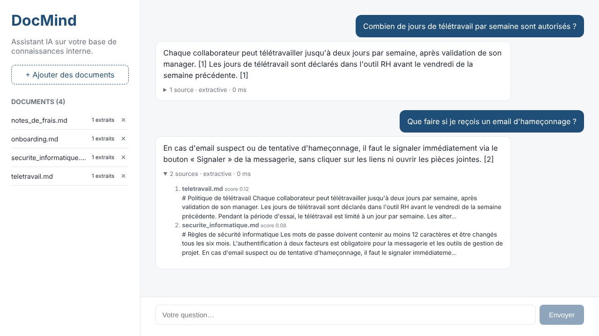
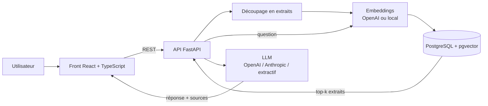

# DocMind – Assistant IA sur une base de connaissances interne


DocMind est une application **full-stack de RAG** (Retrieval-Augmented Generation) : les équipes déposent leurs documents internes (procédures, guides, politiques RH…), puis posent leurs questions en langage naturel. L'assistant répond **en citant ses sources**, et dit clairement quand la réponse n'est pas dans les documents.



## Fonctionnalités

- **Dépôt de documents** Markdown, texte et PDF, découpés en extraits avec chevauchement.
- **Recherche sémantique** dans PostgreSQL + **pgvector** (distance cosinus).
- **Réponses générées par un LLM** au choix : **OpenAI**, **Anthropic (Claude)**, ou un mode **extractif sans clé API** pour tester gratuitement.
- **Sources citées** avec leur score de pertinence, affichées dans l'interface.
- **Évaluation de la recherche** : hit rate@k et MRR sur un jeu de questions annotées, lancée à chaque push dans la CI.
- **API sécurisable** par clé (`X-API-Key`), limite de taille des fichiers, logs structurés.
- **Tests automatisés** (pytest), lint (ruff), **CI GitHub Actions**, déploiement **Docker Compose**.

## Architecture



| Dossier | Contenu |
|---|---|
| `backend/app` | API FastAPI, découpage, embeddings, stockage vectoriel, appel au LLM |
| `backend/tests` | Tests unitaires et tests d'API (pytest) |
| `backend/eval` | Script d'évaluation de la recherche et jeu de questions annotées |
| `frontend` | Interface React + TypeScript (Vite) |
| `sample_docs` | Base de connaissances d'exemple (entreprise fictive) |

Chaque brique est derrière une interface (`Embedder`, `VectorStore`, `LLM`) : on peut passer d'OpenAI à Claude, ou du stockage en mémoire à pgvector, en changeant une seule variable d'environnement.

## Démarrage rapide

### Avec Docker (recommandé)

```bash
cp .env.example .env        # ajoutez votre clé OpenAI ou Anthropic si vous en avez une
docker compose up --build
```

- Interface : http://localhost:5173
- Documentation de l'API (Swagger) : http://localhost:8000/docs

Sans clé API, l'application fonctionne en mode `extractive` : elle renvoie les phrases les plus pertinentes des documents, avec leurs sources.

### En local, sans Docker

```bash
# Back-end
cd backend
python -m venv .venv && source .venv/bin/activate
pip install -r requirements-dev.txt
uvicorn app.main:app --reload

# Front-end (dans un autre terminal)
cd frontend
npm install
npm run dev
```

En local, le stockage se fait en mémoire par défaut (`VECTOR_STORE=memory`).

## Configuration

| Variable | Valeurs | Rôle |
|---|---|---|
| `LLM_PROVIDER` | `openai`, `anthropic`, `extractive` | Modèle qui rédige la réponse |
| `EMBEDDING_PROVIDER` | `openai`, `hashing` | Modèle d'embeddings (`hashing` = local, sans clé) |
| `VECTOR_STORE` | `pgvector`, `memory` | Stockage des vecteurs |
| `CHUNK_SIZE` / `CHUNK_OVERLAP` | ex. `800` / `120` | Taille des extraits et chevauchement |
| `TOP_K` | ex. `4` | Nombre d'extraits envoyés au LLM |
| `API_KEY` | texte libre | Si défini, chaque requête doit envoyer `X-API-Key` |

Les clés API sont lues depuis `.env`, qui est exclu du dépôt par `.gitignore`.

## API

| Méthode | Route | Description |
|---|---|---|
| `GET` | `/health` | État du service |
| `GET` | `/documents` | Liste des documents indexés |
| `POST` | `/documents/upload` | Dépôt d'un fichier `.md`, `.txt` ou `.pdf` |
| `POST` | `/documents/text` | Dépôt d'un texte brut (JSON) |
| `DELETE` | `/documents/{doc_id}` | Suppression d'un document |
| `POST` | `/ask` | Question → réponse, sources, fournisseur, latence |

```bash
curl -X POST http://localhost:8000/ask \
  -H "Content-Type: application/json" \
  -d '{"question": "Combien de jours de télétravail par semaine ?"}'
```

## Qualité et évaluation

```bash
cd backend
pytest -q                                          # 13 tests
python -m eval.evaluate --docs ../sample_docs --k 3
```

Résultat avec les embeddings locaux (`hashing`), sur 12 questions annotées :

| Métrique | Valeur |
|---|---|
| Hit rate@3 | 100 % |
| MRR | 0,92 |

Le MRR (Mean Reciprocal Rank) mesure si le bon document arrive **en premier** : 0,92 signifie qu'il est presque toujours classé premier. Les embeddings OpenAI (`EMBEDDING_PROVIDER=openai`) améliorent encore le classement sur des questions formulées différemment des documents.

## Choix techniques

- **Pourquoi un mode sans clé API ?** Pour que la CI, les tests et une démo tournent sans coût ni secret, et pour pouvoir comparer objectivement les modèles.
- **Pourquoi pgvector plutôt qu'une base vectorielle dédiée ?** Une seule base PostgreSQL pour les métadonnées et les vecteurs : moins d'infrastructure à maintenir pour un outil interne.
- **Pourquoi citer les sources ?** Pour que l'utilisateur puisse vérifier la réponse : le prompt interdit au modèle de répondre hors des extraits fournis.

## Pistes d'amélioration

- Recherche hybride (mots-clés + vecteurs) et re-ranking des extraits
- Réponses en streaming
- Authentification des utilisateurs (JWT) et droits d'accès par document
- Évaluation de la qualité des réponses générées (fidélité aux sources)

## Auteure

**Oumaima Mrhir** – Étudiante en Master 2 Informatique Décisionnelle (IDEAL), Université de Lorraine
[GitHub](https://github.com/OumaimaMrhir)

Licence MIT.
